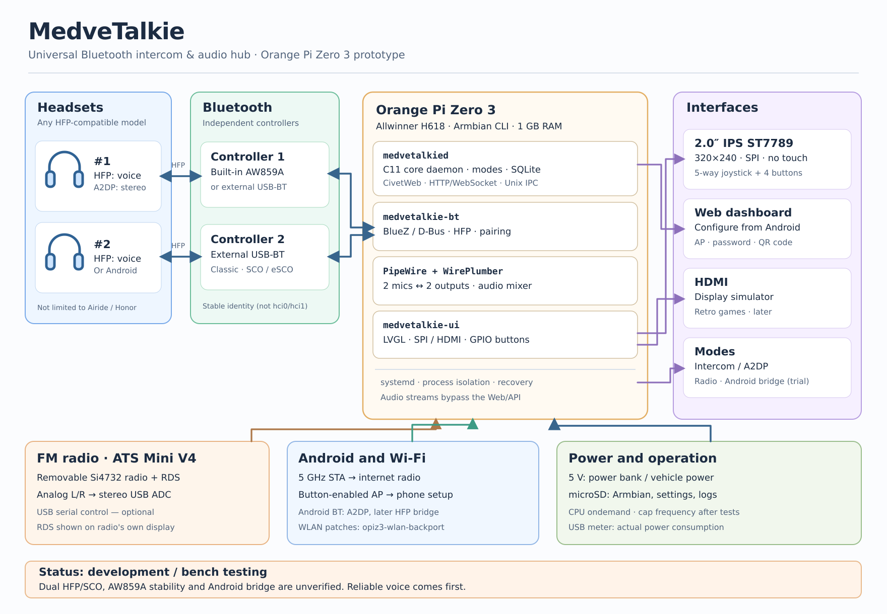

# MedveTalkie

**Experimental open Bluetooth intercom and audio-routing platform for Linux SBCs**

> **Status: early development / hardware validation pending.** There is no verified full-duplex two-headset release yet. Do not rely on this software for safety-critical communication.

MedveTalkie is a modular motorcycle/bicycle intercom prototype built around an Orange Pi Zero 3 (Allwinner H618, 1 GB RAM) running headless Armbian. The project aims to connect two interchangeable Bluetooth Classic headsets in **simultaneous full-duplex HFP/HSP**, route audio using BlueZ and PipeWire, and provide local controls plus a lightweight web UI.

The current priority is **proving stable HFP microphone + speaker operation on real hardware**, not shipping an untested product.

## System overview



*Detailed concept diagram. Bluetooth HFP dual-link capability and Android phone bridging remain subject to hardware validation.*

## Planned features

- Two configurable headset roles (not tied to a particular manufacturer).
- Independent Bluetooth controllers where required; no hard-coded `hci0`/`hci1` or USB bus numbers.
- Two-way speech with microphone isolation, reconnects and device health reporting.
- Solo A2DP stereo playback and experimental Android-phone bridge modes.
- FM from a removable ATS Mini V4 receiver, internet radio via Android Wi-Fi hotspot.
- 2-inch ST7789 SPI status display with physical joystick/buttons; HDMI for development and games.
- Wi-Fi STA at 5 GHz, on-demand AP setup, strong generated credentials and QR pairing.
- Small on-device HTTP/WebSocket UI, no desktop environment required.

## Architecture decision

The native application is **C11**, split into failure-isolated processes:

| Service | Responsibility |
| --- | --- |
| `medvetalkied` | Desired-state machine, settings, commands/events, web API (planned CivetWeb) |
| `medvetalkie-bt` | BlueZ integration, Bluetooth controller/headset lifecycle |
| `medvetalkie-ui` | LVGL UI, SPI/HDMI backend, physical controls |

BlueZ, PipeWire and WirePlumber remain system services. Audio samples are **never routed through HTTP or through the core daemon**. Services will use versioned Unix-domain-socket IPC, with operation IDs and asynchronous completion events. SQLite stores app settings; BlueZ stores bond credentials.

See [Architecture](docs/ARCHITECTURE.md), [hardware validation](docs/VALIDATION.md), [roadmap](docs/ROADMAP.md) and [API design](docs/IPC.md).

## Core API / Web Alpha (development branch)

The `feature/web-alpha-usb-diagnostics` branch adds a C11 Core API
with read-only status and Bluetooth/sysfs inventory, an **opt-in local**
SQLite desired-settings writer, and a separate **read-only** CivetWeb
adapter over a length-prefixed JSON Unix socket. This is the first implementation of the shared control contract
in [docs/IPC.md](docs/IPC.md), not the finished settings interface.

For a development machine with dependencies installed:

```sh
sudo apt-get install -y build-essential cmake libjson-c-dev libsqlite3-dev libdbus-1-dev pkg-config libcivetweb-dev curl
cmake -S . -B build -DCMAKE_BUILD_TYPE=Release
cmake --build build --parallel 2
ctest --test-dir build --output-on-failure

mkdir -p /tmp/medvetalkie-api
./build/medvetalkied --ipc-socket /tmp/medvetalkie-api/core.sock --db-path /tmp/medvetalkie-api/settings.db
# In another terminal, under the same user:
./build/medvetalkie-web --ipc-socket /tmp/medvetalkie-api/core.sock
```

Open `http://127.0.0.1:8765/` **on that same machine**. HTTP is limited to
loopback and serves `/api/v1/health`, `/api/v1/status`,
`/api/v1/capabilities`, `/api/v1/settings`, `/api/v1/display` and
`/api/v1/bt/controllers` and `/api/v1/bt/bluez`.
The controller inventory is **kernel sysfs only**; the separate BlueZ
endpoint reports observed `Adapter1` / `Device1` states (`Powered`, `Paired`,
`Connected`) from system D-Bus. Neither endpoint proves HFP/SCO audio or
pairs a headset. No remote listener, login or modification endpoints
exist; **do not bind it to LAN/0.0.0.0 or proxy it to an untrusted network**.
The IPC server authorizes only same-UID clients for now. To enable the
local SQLite `settings.patch` operation (never over HTTP), start core
with `--allow-local-settings`; it saves desired settings but does not
apply them to hardware.
For real deployment, use systemd RuntimeDirectory and separate authorized
service identities instead of the temporary example above.

To prepare the existing Bjorni screensaver for a **manual** launch, an
optional C11 startup adapter is included; it reads the current desired
display settings through the same IPC and forwards validated integer
`--spi-mhz` and `--fps` parameters without shell interpolation:

```sh
./build/medvetalkie-display-runner \
  --ipc-socket /tmp/medvetalkie-api/core.sock \
  --script /opt/medvetalkie/medvetalkie-screensaver.sh --dry-run
```

The script path must point to an explicitly installed trusted copy of
the Bjorni renderer. The adapter runs it only with `--run` and when
`screensaver_enabled=true`; it does not install the script, manage
services, or implement hot reload. No integrated hardware run is claimed.

The BlueZ source uses native `libdbus-1-dev` in addition to the existing
C11, SQLite and CivetWeb dependencies. The WebUI is still bound to localhost
with no LAN access or authentication; never reverse-proxy it publicly.

The physical display, bootable Armbian image and USB-BT bench work are in
the separate `work/uwe5622-wifi-armbian` branch. These branches have **not**
yet been integrated into one tested SD-card image.

## Current state

The default `main` still contains the original C11 skeleton. The Web Alpha branch implements loopback-only CivetWeb, SQLite desired settings and passive HCI/USB inventory; actual HFP routing, authenticated remotely accessible WebUI, LVGL and installation automation remain unimplemented. Do not use this experimental code for riding.

### Build skeleton on Debian / Armbian

```sh
sudo apt update
sudo apt install -y build-essential cmake
cmake -S . -B build -DCMAKE_BUILD_TYPE=Release
cmake --build build --parallel
```

Do not enable the daemons as boot services until the state machine and recovery paths have been implemented and tested.

## Hardware test bench

- Orange Pi Zero 3, 1 GB, Armbian CLI, wired Ethernet for initial bring-up.
- Two HFP-capable Bluetooth Classic headsets; initial test devices may be Airide N1 and Honor, but these are **not hard-coded requirements**.
- Built-in AW859A/UWE5622 radio; add independent USB Bluetooth Classic controllers if needed.
- USB power meter for repeatable idle, Wi-Fi and duplex power measurements.

Relevant AW859A Wi-Fi stabilization reference: [Medvedolog/opiz3-wlan-backport](https://github.com/Medvedolog/opiz3-wlan-backport). Patches must be rebased and verified for the actual Armbian kernel; nothing is assumed applied.

## Contribution and licensing

Contributions and hardware validation reports are welcome. **A source license has not yet been selected.** Until a license is added, do not assume that public repository access grants redistribution rights. Do not copy implementation code from projects with restrictive licenses; independently implement shared technical ideas and cite field observations.

[Русская документация](README.ru.md).
