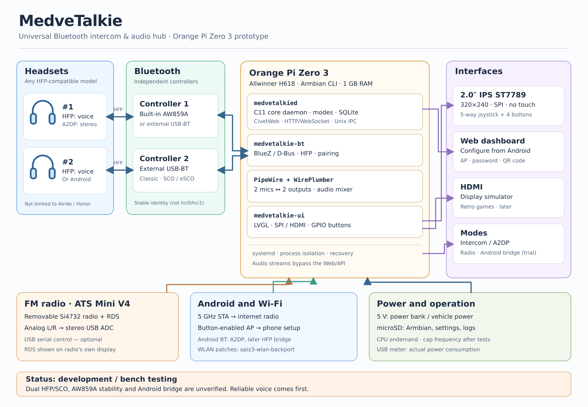

# MedveTalkie

**Experimental open Bluetooth intercom and audio-routing platform for Linux SBCs**

> **Status: early development / hardware validation pending.** There is no verified full-duplex two-headset release yet. Do not rely on this software for safety-critical communication.

MedveTalkie is a modular motorcycle/bicycle intercom prototype built around an Orange Pi Zero 3 (Allwinner H618, 1 GB RAM) running headless Armbian. The project aims to connect two interchangeable Bluetooth Classic headsets in **simultaneous full-duplex HFP/HSP**, route audio using BlueZ and PipeWire, and provide local controls plus a lightweight web UI.

The current priority is **proving stable HFP microphone + speaker operation on real hardware**, not shipping an untested product.

## System overview



*Detailed concept diagram. Bluetooth HFP dual-link capability and Android phone bridging remain subject to hardware validation.*

## Planned features

- Two configurable headset roles (not tied to a particular manufacturer).
- Independent Bluetooth controllers where required; no hard-coded `hci0`/`hci1` or USB bus numbers.
- Two-way speech with microphone isolation, reconnects and device health reporting.
- Solo A2DP stereo playback and experimental Android-phone bridge modes.
- FM from a removable ATS Mini V4 receiver, internet radio via Android Wi-Fi hotspot.
- 2-inch ST7789 SPI status display with physical joystick/buttons; HDMI for development and games.
- Wi-Fi STA at 5 GHz, on-demand AP setup, strong generated credentials and QR pairing.
- Small on-device HTTP/WebSocket UI, no desktop environment required.

## Architecture decision

The native application is **C11**, split into failure-isolated processes:

| Service | Responsibility |
| --- | --- |
| `medvetalkied` | Desired-state machine, settings, commands/events, web API (planned CivetWeb) |
| `medvetalkie-bt` | BlueZ integration, Bluetooth controller/headset lifecycle |
| `medvetalkie-ui` | LVGL UI, SPI/HDMI backend, physical controls |

BlueZ, PipeWire and WirePlumber remain system services. Audio samples are **never routed through HTTP or through the core daemon**. Services will use versioned Unix-domain-socket IPC, with operation IDs and asynchronous completion events. SQLite stores app settings; BlueZ stores bond credentials.

See [Architecture](docs/ARCHITECTURE.md), [hardware validation](docs/VALIDATION.md), [roadmap](docs/ROADMAP.md) and [API design](docs/IPC.md).

## Current state

This initial repository contains the architecture and a basic buildable C11 process skeleton. **HFP routing, CivetWeb, LVGL, hardware access and installation automation are not yet implemented.** The skeleton is not intended for real riding.

### Build skeleton on Debian / Armbian

```sh
sudo apt update
sudo apt install -y build-essential cmake
cmake -S . -B build -DCMAKE_BUILD_TYPE=Release
cmake --build build --parallel
```

Do not enable the daemons as boot services until the state machine and recovery paths have been implemented and tested.

## Hardware test bench

- Orange Pi Zero 3, 1 GB, Armbian CLI, wired Ethernet for initial bring-up.
- Two HFP-capable Bluetooth Classic headsets; initial test devices may be Airide N1 and Honor, but these are **not hard-coded requirements**.
- Built-in AW859A/UWE5622 radio; add independent USB Bluetooth Classic controllers if needed.
- USB power meter for repeatable idle, Wi-Fi and duplex power measurements.

Relevant AW859A Wi-Fi stabilization reference: [Medvedolog/opiz3-wlan-backport](https://github.com/Medvedolog/opiz3-wlan-backport). Patches must be rebased and verified for the actual Armbian kernel; nothing is assumed applied.

## Contribution and licensing

Contributions and hardware validation reports are welcome. **A source license has not yet been selected.** Until a license is added, do not assume that public repository access grants redistribution rights. Do not copy implementation code from projects with restrictive licenses; independently implement shared technical ideas and cite field observations.

[Русская документация](README.ru.md).
